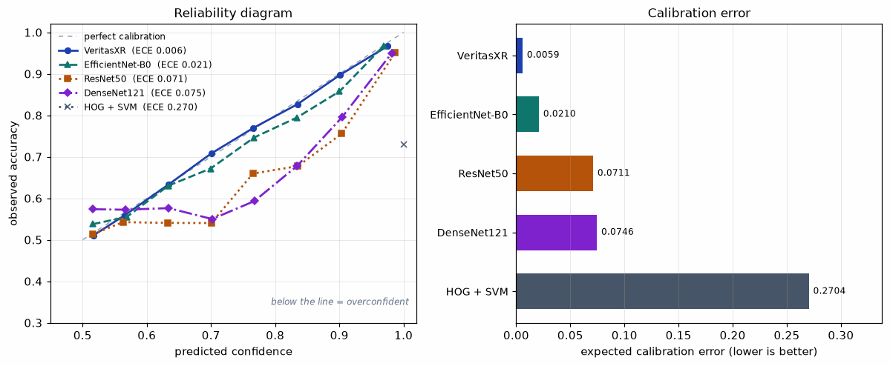

# VeritasXR — A Comparative Study of CNN Architectures for Chest Radiograph Classification

A custom dual-pathway CNN evaluated against three ImageNet-pretrained CNNs and a
classical computer-vision baseline on chest radiographs, under a single shared
training protocol.

The architecture runs two convolutional branches in parallel over a shared
stem, differing only in kernel size. At 4.22M parameters it reaches an AUPRC of
0.6410 ± 0.0039 over three seeds, against 0.6993 ± 0.0033 for the strongest
pretrained baseline. A paired bootstrap run on each seed separates every pair
on every seed, so the gap is real rather than noise.

It was designed to use the disagreement between its two branches as an
uncertainty signal. That was implemented, measured, and found not to work:
against the model's own errors it scores AUROC 0.5334, which is chance. The
model reports predictive entropy instead, and the negative result is kept
rather than quietly dropped — along with two others, since neither the
per-input merge gate nor squeeze-excitation survives a multi-seed ablation.
Calibration looked like the one win until it was replicated: on three seeds
VeritasXR is second, not first, and a single temperature fitted on validation
puts it last. **It wins no metric here.** What the study produces instead is a
measured account of why, and four separate cases of a single seed reporting a
result that reverses on replication.

**Not a medical device.** This is a research artifact. It is not validated for
clinical use and must not inform any diagnosis or treatment decision.

## Results

Test set: 4,006 radiographs, 22.5% positive. Three seeds per model, reported as
mean ± standard deviation.

| Model | Params | AUPRC | AUROC | F1 | Bal. acc |
|---|---|---|---|---|---|
| EfficientNet-B0 | 4.01M | **0.6993 ± 0.0033** | 0.8781 ± 0.0026 | 0.6182 | 0.7880 |
| DenseNet121 | 6.96M | 0.6872 ± 0.0034 | 0.8728 ± 0.0016 | 0.6166 | 0.7893 |
| ResNet50 | 23.51M | 0.6747 ± 0.0072 | 0.8675 ± 0.0032 | 0.6267 | 0.7772 |
| **VeritasXR** | **4.22M** | 0.6410 ± 0.0039 | 0.8531 ± 0.0028 | 0.5988 | 0.7670 |
| HOG + linear SVM | 6,085 feat | 0.3823 ± 0.0010 | 0.7283 ± 0.0009 | 0.5398 | 0.7207 |

Differences are tested by paired bootstrap over 2,000 resamples: both models
are scored on the *same* resampled test cases, so the shared difficulty of
those cases cancels. **Run independently on each of the three seeds** — the
version of this table that shipped first was seed 0 only, which is why its
figures did not reconcile with the mean AUPRC column above. Δ is the mean over
seeds, and the p column reports the *weakest* seed rather than the best, after
a Holm correction over the whole family of 12 tests.

| Comparison | Δ AUPRC | 95% CI | worst-seed p | Seeds separating |
|---|---|---|---|---|
| EfficientNet-B0 − VeritasXR | +0.0581 | [+0.0377, +0.0784] | < 0.0001 | 3 / 3 |
| DenseNet121 − VeritasXR | +0.0459 | [+0.0267, +0.0651] | < 0.0001 | 3 / 3 |
| ResNet50 − VeritasXR | +0.0335 | [+0.0128, +0.0537] | 0.0140 | 3 / 3 |
| HOG + linear SVM − VeritasXR | −0.2589 | [−0.2850, −0.2326] | < 0.0001 | 3 / 3 |

Four readings:

- **Every pretrained baseline beats VeritasXR, significantly.** The gap is
  0.034–0.058 AUPRC, every paired interval excludes zero, and it does so on all
  three seeds independently. ImageNet initialisation is worth roughly 5–9%
  relative AUPRC on this task, and training from scratch on 18,677 images does
  not close it.
- **Capacity is not the limiting factor.** ResNet50 carries 5.6x the parameters
  of EfficientNet-B0, finishes third, and has the highest seed-to-seed variance
  of any model (±0.0072). On a dataset this size more model buys instability,
  not accuracy.
- **Deep learning earns its place, measurably.** The classical control sits
  0.259 AUPRC below the custom model, with the paired interval far from zero.
  That gap is a result rather than an assumption.
- **The cheap pathway does most of the work.** In the ablation, the 3x3 branch
  alone (1.01M parameters) outperforms the 7x7 branch alone (3.30M), and comes
  within 0.0126 of the full model using 24% of its parameters.

A note on method, because the two analyses disagree: the marginal 95% intervals
for VeritasXR and the pretrained models overlap, which invites the conclusion
that the difference is unresolved. That inference is wrong. Overlapping
marginal intervals do not imply the absence of a significant difference; the
paired test above is the correct comparison and it separates every pair on
every seed. The weakest of those twelve tests is ResNet50 on its best seed, at
p = 0.014; the rest are below 0.0001. Quoting p < 0.0001 for all of them, as
this section did while the test ran on seed 0 alone, overstated it.

### The operating point matters more than it looks

Every threshold-dependent metric above is computed at a fixed 0.5. That is not
a neutral choice. Training uses a class-weighted loss, which shifts
predictions, and these models differ in calibration by more than an order of
magnitude, so 0.5 sits at a different place on each one's distribution.

Tuning the threshold on the validation split — never on test:

| Model | Tuned t | F1 @ 0.5 | F1 @ tuned | Δ |
|---|---|---|---|---|
| EfficientNet-B0 | 0.63 | 0.6182 | **0.6431** | +0.0249 |
| DenseNet121 | 0.65 | 0.6166 | 0.6339 | +0.0173 |
| ResNet50 | 0.49 | 0.6267 | 0.6282 | +0.0015 |
| VeritasXR | 0.55 | 0.5989 | 0.5961 | −0.0028 |

**The F1 ranking changes.** At 0.5 it reads ResNet50 > EfficientNet-B0 >
DenseNet121, which contradicts AUPRC and AUROC — both threshold-free, and both
ranking EfficientNet-B0 first. Tuned, the ordering becomes EfficientNet-B0 >
DenseNet121 > ResNet50 and the contradiction disappears.

The reason is visible in the tuned thresholds themselves: ResNet50's optimum is
0.49, essentially the default, so it was already being evaluated at its best
point while the others were not. An F1 column at a fixed cut was therefore
measuring how well each model's calibration happened to suit 0.5, not how well
it separates the classes.

VeritasXR is last under either convention, so the correction does not flatter
it. It is included because an evaluation that only gets fixed when the result
improves is not an evaluation.

**Accuracy is deliberately absent from the headline.** At 22.5% prevalence a
model that always predicts negative scores 77.5% accuracy while detecting
nothing. Accuracy is recorded in the run artifacts for completeness and is never
used to select a checkpoint; AUPRC is.

## Ablation

Each variant removes or replaces one component of the custom model, trained
across three seeds.

| Variant | Params | AUPRC | Δ vs full | Paired test across seeds |
|---|---|---|---|---|
| `concat_merge` | 4,264,310 | 0.6422 ± 0.0060 | +0.0011 | sign flips |
| `full` | 4,215,352 | 0.6410 ± 0.0039 | — | — |
| `fixed_merge` | 4,166,006 | 0.6394 ± 0.0017 | −0.0016 | sign flips |
| `scalar_merge` | 4,166,008 | 0.6360 ± 0.0054 | −0.0051 | consistent, never separated |
| `no_se` | 4,177,672 | 0.6348 ± 0.0068 | −0.0062 | sign flips |
| `global_only` | 3,302,108 | 0.6337 ± 0.0081 | −0.0073 | sign flips |
| **`local_only`** | **1,008,348** | 0.6205 ± 0.0131 | **−0.0205** | **consistent, all 3 seeds** |

Significance is a paired bootstrap on the test set, run separately per seed —
both models scored on the same resampled cases — rather than a rule of thumb
over three seed means. Per-seed differences against `full`:

| Variant | seed 0 | seed 1 | seed 2 |
|---|---|---|---|
| `local_only` | −0.0124 | −0.0063 | −0.0425 ** |
| `scalar_merge` | −0.0024 | −0.0070 | −0.0047 |
| `global_only` | −0.0190 ** | **+0.0076** | −0.0102 |
| `no_se` | −0.0090 | **+0.0079** | −0.0167 ** |
| `concat_merge` | −0.0083 | **+0.0081** | +0.0038 |
| `fixed_merge` | −0.0034 | **+0.0060** | −0.0072 |

`**` marks a paired 95% interval excluding zero for that seed.

**Exactly one result survives the seeds.** `local_only` — the variant that
keeps only the 3x3 branch — is worse than the full model on all three seeds,
so **removing the 7x7 global pathway reliably costs accuracy**. Its magnitude
is unstable (−0.0063 to −0.0425) and it separates on only one seed
individually, so the honest claim is a consistent direction rather than a
precise effect size.

**Every other component changes sign depending on the seed.** Squeeze-excitation,
a fixed 50/50 blend and concatenation each help on one seed and hurt on
another. `global_only` is the sharpest warning: it separates on seed 0 and then
*reverses* on seed 1. None of these design decisions is doing measurable work
on this task, and any of them would have looked meaningful from a single run.

`scalar_merge` is consistently slightly below `full` without ever separating,
which is the weakest possible support for the per-input gate: a hint, not a
result.

A note on why this is stated so carefully. On seed 0 alone the ordering was the
opposite — `local_only` scored 0.6300 against `global_only` at 0.6233,
suggesting the cheap 3x3 branch outperformed the expensive 7x7 one. Across
three seeds that reverses: seed 0 caught `global_only` at its worst (0.6233
against 0.6432 and 0.6344) and `local_only` near its best. One seed produced a
cleaner, more attractive, and wrong story. That is the argument for the seeds,
and for the per-seed table above rather than an average that hides the flips.

As a code check, `veritasxr_full` and the plain `veritasxr` run differ by
exactly 0.0000 on every seed, confirming the ablation path and the default path
construct the same model.

## Architecture

```
input 1x224x224
  |
  stem: Conv 11x11 s2 -> Conv 3x3 -> MaxPool          64x56x56
  |
  +-- local pathway  (3x3 kernels)  3 bottleneck stages -> SE -> GAP   384
  +-- global pathway (7x7 kernels)  3 bottleneck stages -> SE -> GAP   384
  |
  gate: softmax(MLP([local; global]))                 per-input weights
  merged = w0*local + w1*global
  |
  +-- classifier -> verdict (2 logits)
  +-- per-pathway linear heads -> Jensen-Shannon divergence -> uncertainty
```

| Decision | Reason |
|---|---|
| 11x11 stem | Radiographic signal is diffuse texture rather than sharp edges, so the first layer looks wide |
| Two kernel scales | Each unit in the 3x3 branch sees 75 px of the 224 px field, against 187 px in the 7x7 branch — local detail against whole-lung structure |
| Squeeze-excitation | Channel attention using global context, 8,464 parameters per branch |
| Per-input merge gate | Blend weights are predicted from the image, not learned as a dataset-wide constant |
| Derived uncertainty | Predictive entropy of the verdict. No part of the uncertainty path is a free parameter, so it cannot silently go untrained. Pathway disagreement was the original design and is reported but not used — see below |

### Pathway disagreement does not work, and that is a result

The architecture was designed around a specific idea: run two pathways, and use
the divergence between their predictions as the uncertainty estimate. The idea
is implemented, parameter-free, and fully trained. It also does not work.

Measured against whether the model is actually wrong, over the **full test set
of 4,006 images on all three seeds**. The first version of this table used
800 images and one seed; it is the table the demo's triage rests on, so it is
the last place in this study that should be a single draw.

| Signal | AUROC vs. model error |
|---|---|
| Predictive entropy of the verdict | **0.7747 ± 0.0103** |
| Entropy + 5x disagreement | 0.7675 ± 0.0077 — *worse* than entropy alone |
| Jensen-Shannon pathway disagreement | **0.5334 ± 0.0090** — chance |

Disagreement carries essentially no information about correctness, and adding
it to a signal that works degrades that signal. On the full test set it scores
0.5334 rather than the 0.5046 the 800-image subset reported — still
indistinguishable from chance and the conclusion is unchanged, but the subset
was flattering the negative result rather than the design. The cause is
structural rather than a bug: both pathway heads are supervised on the same
labels with the same loss, so they converge toward each other. Their divergence
never exceeds 0.316 on any seed, so under the originally intended
0.4 / 0.7 thresholds **100% of cases landed in "high confidence"** and the
triage was decorative.

The model therefore reports predictive entropy as its uncertainty, with bands
set at the 60th and 85th percentile of entropy on the validation split.
**Those cuts belong to one trained model, not to the architecture**: the 60th
percentile is 0.8271, 0.7473 and 0.6500 on the three seeds. The demo serves
the seed-0 checkpoint and uses seed 0's cuts.

Selective prediction on that signal behaves as it should:

| Coverage | Accuracy on retained cases |
|---|---|
| most confident 25% | 0.9767 ± 0.0062 |
| most confident 50% | 0.9221 ± 0.0045 |
| most confident 75% | 0.8465 ± 0.0081 |
| all cases | 0.7700 ± 0.0083 |

Disagreement is still computed and exposed, labelled as a measured negative
result rather than removed, because the negative result is the honest output of
having tested the design.

## Calibration — are the probabilities believable?

AUPRC only grades ranking. A model can order cases perfectly while being
systematically overconfident, and that matters here: the triage bands are read
off the predicted distribution, so inflated probabilities produce inflated
bands. Measured on the test set with 15 bins, **averaged over three seeds**.

| Model | ECE | MCE | Brier | Mean confidence | Accuracy | Gap |
|---|---|---|---|---|---|---|
| EfficientNet-B0 | 0.0343 ± 0.0138 | 0.0807 | 0.1541 | 0.8046 | 0.7711 | +0.0335 |
| **VeritasXR** | 0.0440 ± 0.0295 | 0.0947 | 0.1519 | 0.8132 | 0.7699 | +0.0433 |
| ResNet50 | 0.0599 ± 0.0086 | 0.1210 | 0.1374 | 0.8636 | 0.8040 | +0.0596 |
| DenseNet121 | 0.0670 ± 0.0100 | 0.1397 | 0.1567 | 0.8316 | 0.7670 | +0.0646 |
| HOG + linear SVM | 0.2715 ± 0.0014 | 0.7736 | 0.2713 | 0.9996 | 0.7283 | +0.2713 |



**This section previously reported a 12x calibration win for VeritasXR. That
was one seed.** The table above was built from seed 0 alone, and seed 0 is
VeritasXR's best draw by a wide margin: its ECE across the three seeds is
0.0059, 0.0482, 0.0778. Averaged properly it is second, not
first, and its margin over the worst deep model is 1.5x rather than 12x. Its
seed spread (± 0.0295) is also the largest of the four,
so it is the least predictable of them on the metric it was supposed to own.
This is the fourth time in this study that a single seed produced a result that
reversed on replication, which is the finding worth carrying out of it.

**EfficientNet-B0 is the best-calibrated model as well as the most accurate**,
at 0.0343. Every model is overconfident — the gap
column is positive for all five — which is the expected direction when a
probability is read as a probability.

### The objection: calibration is cheap to buy

Calibration is a property you can add after training. One temperature fitted on
the validation split, applied to the test logits, leaves the ranking exactly
unchanged — AUPRC and AUROC are invariant under it, which the script asserts —
and moves an overconfident model onto the diagonal. If the baselines close the
gap for the price of one scalar, then "best calibrated" describes VeritasXR's
default output scale rather than anything the architecture does.

They do, and then some:

| Model | Fitted T | ECE before | ECE after | Brier before | Brier after |
|---|---|---|---|---|---|
| ResNet50 | 1.521 | 0.0599 | 0.0145 | 0.1374 | 0.1325 |
| EfficientNet-B0 | 1.216 | 0.0343 | 0.0151 | 0.1541 | 0.1526 |
| **VeritasXR** | 1.229 | 0.0440 | 0.0219 | 0.1519 | 0.1489 |
| DenseNet121 | 1.448 | 0.0670 | 0.0248 | 0.1567 | 0.1513 |

**After temperature scaling VeritasXR is last of the four.** ResNet50 goes from
worst deep model to best, because its miscalibration is almost entirely a scale
error — T = 1.52 corrects nearly all of it. VeritasXR's fitted temperature is
closest to 1 on seed 0 (0.974, i.e. essentially already calibrated), but across
seeds it needs 1.229 and what remains after scaling is not a scale error, so
scaling cannot remove it.

The honest summary is therefore: **VeritasXR wins no metric in this study.** It
is competitive on calibration out of the box and that is worth stating, but the
advantage is seed-dependent, smaller than one seed suggested, and erased by a
one-parameter post-hoc fit that any of these models can have for free.

Two caveats that still hold:

- **ResNet50 has the best Brier score** (0.1374) despite a
  worse ECE. Brier combines calibration with refinement, and ResNet50's higher
  accuracy offsets its overconfidence. Different metrics favour different models.
- **HOG + SVM's 0.9996 mean confidence is an artifact, not a property of the
  classifier.** Its scores are a logistic squash of an unbounded SVM margin,
  which saturates. Its calibration figure describes that mapping, not the model.
  It is excluded from the temperature table for the same reason: fitting a
  temperature there fits the squash.

## Localisation — where is each model looking?

RSNA ships bounding boxes drawn by board-certified radiologists around the
opacities they identified, which allows a question the accuracy table cannot
answer: when a model says pneumonia, is it looking at the right place?

Scored over all 903 positive test images, **averaged across three seeds** with
the seed-to-seed spread reported. That spread is not decoration: a single seed
reversed this study's pathway ordering once already.

| Model / pathway | Pointing game | Mass in box | IoU @ 0.5 |
|---|---|---|---|
| **EfficientNet-B0** | **0.7154 ± 0.0177** | 0.3531 | 0.2837 |
| ResNet50 | 0.4042 ± **0.1475** | 0.2221 | 0.1596 |
| DenseNet121 | 0.3178 ± 0.0356 | 0.2005 | 0.2160 |
| VeritasXR — local (3x3) | 0.2979 ± 0.0619 | 0.1372 | 0.1334 |
| VeritasXR — merged (gated) | 0.2348 ± 0.0178 | **0.1510** | **0.1595** |
| VeritasXR — global (7x7) | 0.2270 ± 0.0276 | 0.1499 | 0.1545 |
| *chance (random point)* | *0.1240* | — | — |

A random point lands in a box 12.40% of the time and the boxes cover 11.73% of
the image, so the chance figure is consistent with the annotation density.

**The metrics disagree about the pathways, and that is the finding.** The local
3x3 branch places its single peak inside a box more often (0.2979 against
0.2270), while the global 7x7 branch concentrates more activation mass inside
the boxes and overlaps them better (0.1499 and 0.1545 against 0.1372 and
0.1334). Neither branch dominates. Read with the ablation, where removing the
global branch is the only change that significantly hurts classification, the
picture is that the two pathways contribute differently rather than one being
redundant — which is what the architecture intended, even though the intended
*benefit* does not materialise.

The merged row is the map the model actually computes: the two pathway CAMs
combined with the model's own per-input gate weights, not an equal blend. It
is the best of the three on mass-in-box and IoU and the most stable of them
(± 0.0178), while the local pathway alone keeps the best pointing score. So
the fusion does buy something measurable — in *where the attention sits*,
which is the one place the architecture's premise survives contact with the
data.

Their peaks coincide on 7.05% of images, so the branches are genuinely not
duplicates.

**EfficientNet-B0 is the best localiser as well as the best classifier**, at
5.8x chance, and it is also the most stable (± 0.0177). Those properties need
not travel together.

**ResNet50's attention is unstable across seeds.** At ± 0.1475 its pointing
score ranges from 0.2027 to 0.5515 depending only on the random seed. Its
classification accuracy is far steadier than that, so a single-seed Grad-CAM
figure from this model would say more about the seed than the architecture.

## Dataset

**RSNA Pneumonia Detection Challenge** — 26,684 labelled radiographs of adults
from multiple sites, annotated by one to three board-certified radiologists with
bounding boxes around opacities.

| Class | Images | Share |
|---|---|---|
| No Lung Opacity / Not Normal | 11,821 | 44.3% |
| Normal | 8,851 | 33.2% |
| Lung Opacity (`Target=1`) | 6,012 | 22.5% |

Split by patient into 18,677 train / 4,001 validation / 4,006 test. Splits are
stratified on the **three-class** label rather than the binary target, so the
hard middle class — radiographically abnormal but not pneumonia, and 44% of the
data — stays proportional across splits. `tests/test_no_leakage.py` asserts no
patient appears in more than one split, and fails if a leak is injected.

The primary task is binary pneumonia detection; every manifest carries the
three-class label, so the three-class variant is a configuration change.

## Comparability

Every model reads one configuration file. Loss, optimiser, learning rate,
schedule, augmentation, mixed-precision policy, early-stopping rule and
checkpoint-selection metric are shared, so differences in the results table are
attributable to the model rather than to the setup.

Only two things vary per model, both recorded in `configs/default.yaml` with
their justification:

- **Channel count and normalisation.** An ImageNet-pretrained backbone needs
  three channels and its own statistics for its weights to mean anything; the
  custom model is natively single-channel. This is correct usage, not a
  confound.
- **The classical baseline has no epochs.** Learning rate and schedule are
  undefined for an SVM, so its departures are listed in a `deviations` field in
  its own results rather than glossed over. It shares the data, the splits, the
  class-weighting and the results contract.

### Was the shared learning rate unfair to anyone?

The shared rate is what makes this a comparison, and it is also the most
obvious thing to blame for the custom model's deficit — a from-scratch model
may want a different rate than a fine-tuned one. So it was measured. Every deep
model retrained at a third of the shared rate and at three times it, seed 0.

| Model | 1e-4 | 3e-4 *(shared)* | 1e-3 | Best − shared |
|---|---|---|---|---|
| EfficientNet-B0 | 0.6954 | 0.7009 | **0.7025** | +0.0016 |
| DenseNet121 | **0.6961** | 0.6824 | 0.6668 | +0.0137 |
| ResNet50 | **0.6880** | 0.6849 | 0.6257 | +0.0031 |
| **VeritasXR** | 0.6316 | 0.6426 | **0.6445** | +0.0019 |

**The confound is real for one model and it points the wrong way.**
DenseNet121 was genuinely handicapped: at its own rate of 1e-4 it gains +0.0137
AUPRC. VeritasXR gains +0.0019. So tuning each model
individually *widens* the gap to VeritasXR rather than closing it, because the
baselines have more to gain from it than the custom model does. That is the
opposite of the result this probe was run in the hope of finding, which is why
it is worth reporting.

ResNet50 at 1e-3 is the other half of the picture: it drops to
0.6257, well below every other configuration in the table.
A single shared rate does not sit at any model's optimum, but it sits inside
the stable region for all four, and the published results use it for every
model including the one it suits least.

The grid is one seed and three rates, and it does not interact with batch size
or schedule, so it bounds the effect rather than ruling it out.

### Threats to validity

Stated here rather than left for a reader to find.

- **VeritasXR carries one hyperparameter the baselines do not.** Its per-pathway
  heads are supervised with an auxiliary loss at weight 0.3. That is an extra
  degree of freedom in the custom model's favour, though it was fixed at 0.3 by
  choice rather than tuned, so it is unexercised freedom rather than an
  advantage taken.
- **The validation split does double duty.** It selects the checkpoint by early
  stopping and then tunes the operating point. Both uses are legitimate and
  neither touches test, but reusing one split for two selections makes the
  validation figures slightly optimistic as estimates of held-out performance.
- **Many paired tests were run**, so some would separate by chance at a nominal
  5% level. The main comparison is now Holm-corrected over its whole family of
  12 tests (four models × three seeds) and every one of them still separates;
  the weakest, ResNet50 on its worst seed, is p = 0.014 corrected. The
  ablation is reported by sign consistency across seeds rather than by counting
  separations, for the same reason: a variant that separates on one seed and
  reverses on another is exactly what a false positive looks like.
- **The classical baseline has no tuned operating point.** Its scores are a
  logistic squash of an unbounded SVM margin and saturate near 1, so a threshold
  on them is not comparable to one on a calibrated probability. Its
  threshold-dependent metrics stay at 0.5 and should be read as indicative.
- **Class weighting and threshold tuning overlap.** Training reweights the
  classes and evaluation then tunes the decision threshold, which partially
  undoes the shift. Both are applied identically to every deep model, so the
  comparison is unaffected, but neither is independent of the other.

Augmentation deliberately excludes horizontal flipping. Mirroring a chest
radiograph places the heart on the right, which is situs inversus — a rare
pathology, not a valid view of a normal chest.

## Performance

Measured on an RTX 3070 Ti Laptop (8 GB), batch 32, 8 dataloader workers.

| Model | it/s | min/epoch |
|---|---|---|
| VeritasXR | 7.94 | 1.22 |
| ResNet50 | 5.04 | 1.93 |
| EfficientNet-B0 | 3.66 | 2.66 |
| DenseNet121 | 2.11 | 4.61 |

DenseNet121 is the slowest of the four despite holding 6.96M parameters against
ResNet50's 23.51M: its concatenation-heavy design is memory-bandwidth bound.
Throughput here is set by per-model GPU behaviour, not by parameter count.

**Measured and rejected: GPU-side batched augmentation.** The data loader in
isolation reaches 27.9 it/s decoding only, against 13.3 with single-channel CPU
augmentation, which suggested augmentation was the bottleneck. Moving it to the
GPU as per-sample affine matrices measured **1.02x end to end**, and 0.93x for
VeritasXR — the loader-only figures were taken with all cores idle and no GPU
work competing, and augmentation was never on the critical path. Worth recording
so it is not rediscovered.

## Models compared

| Model | Class | Params |
|---|---|---|
| HOG + linear SVM | classical computer vision, no deep learning | 6,085 features |
| ResNet50 | residual CNN, ImageNet pretrained | 23.51M |
| DenseNet121 | dense CNN, ImageNet pretrained (CheXNet backbone) | 6.96M |
| EfficientNet-B0 | efficient CNN, ImageNet pretrained | 4.01M |
| VeritasXR | custom dual-pathway CNN, trained from scratch | 4.22M |

Parameter counts are measured with a two-class head, not the ImageNet
1000-class figures usually quoted. EfficientNet-B0 is the size-matched
comparison for VeritasXR; the HOG + SVM entry is the control for whether deep
learning is needed at all.

## Layout

```
configs/default.yaml          the shared training recipe
scripts/
├── prepare_rsna.py           DICOM -> PNG cache + patient-wise manifests
├── export_web_data.py        run artifacts -> docs/data/summary.json
├── eval_thresholds.py        validation-tuned operating points
├── eval_calibration.py       reliability, ECE, Brier, per seed
├── eval_temperature.py       does the calibration edge survive one scalar?
├── eval_uncertainty.py       entropy vs disagreement against model error
├── eval_localisation.py      attention vs radiologist boxes
├── lr_probe.sh, _round2.sh   per-model learning-rate grid
├── export_onnx.py            checkpoint -> browser model
├── check_onnx_parity.py      ONNX must reproduce PyTorch
├── make_cam_figure.py        the localisation figure
├── make_calibration_figure.py  the reliability figure
└── stamp_assets.py           content-hash cache busting
audit/
├── verify_numbers.py         recompute every headline number from artifacts
├── check_readme_numbers.py   README and site vs the data files; retracted claims
├── ablation_significance.py  paired bootstrap per seed over the variants
├── threshold_check.py        operating-point sensitivity
└── render_check.mjs          run each page's JS against a stub DOM
src/
├── data/                     manifest-backed dataset
├── models/                   architecture and model registry
├── training/                 shared harness, classical baseline
└── evaluation/               localisation scoring
tests/
├── test_no_leakage.py        split integrity, with an injected-leak control
└── test_model.py             gradient coverage, per-input gate, parameter budget
docs/                         the static site
train.py                      entry point
```

## Setup

```bash
python -m venv .venv && ./.venv/bin/pip install -r requirements.txt
```

Requires an NVIDIA GPU for training. The dataset is the
[RSNA Pneumonia Detection Challenge](https://www.kaggle.com/c/rsna-pneumonia-detection-challenge)
on Kaggle; accept the competition rules and place the archive in `data/raw/`.

## Running it

```bash
# 1. build the dataset: DICOM -> PNG cache + patient-wise manifests
python scripts/prepare_rsna.py --raw data/raw --out data/processed

# 2. the gate: splits must be leakage-free before anything trains
python tests/test_no_leakage.py

# 3. architecture checks: gradient coverage, per-input gate, parameter budget
python tests/test_model.py

# 4. smoke test -- one epoch over a few batches for all five models
python train.py --smoke

# 5. a single run, every model across every seed, or the ablation sweep
python train.py --model veritasxr --seed 0
python train.py --model all
python train.py --model veritasxr --ablation all

# 6. regenerate the site's data
python scripts/export_web_data.py
```

Results land in `results/<model>_seed<seed>/` as `metrics.json`,
`progress.csv` and `test_scores.npz`. Per-sample test scores are saved so that
bootstrap intervals and significance tests can be run without retraining.

## Limitations

- Single dataset, single task, no external validation cohort.
- The learning-rate probe is one seed per rate and three rates; it bounds
  the effect of the shared rate rather than ruling it out.
- Labels derive from radiologist report review, not confirmed microbiology.
- Uncertainty is predictive entropy, which is an aleatoric signal; the
  epistemic signal this architecture was built around does not work (above).
- Results in the table above are from one seed; multi-seed intervals are
  regenerated by re-running the exporter once additional seeds complete.
